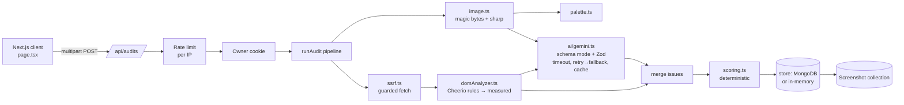

# PixelRoast Pro

**An AI-assisted UI/UX and accessibility auditor.** Give it a screenshot, a live URL, or raw HTML and get a scored report: categorized issues, numbered pins on the screenshot, and copy-pasteable code fixes.

What sets it apart from "ask an LLM to rate my UI": **every issue says how it was found.**

- **Measured** issues come from deterministic rules run on the page's real markup (missing alt text, unlabeled fields, nameless buttons, skipped headings, missing `lang`, disabled zoom…). The same input always gives the same result.
- **AI-estimated** issues come from Gemini vision and cover what needs judgement: visual hierarchy, CTA clarity, copy, perceived contrast.
- **Scores are computed by a documented formula from the issues. The AI never produces a score**, and switching persona changes only the tone of the summary.

## Live app

**https://pixelroast.vercel.app** — deployed on Vercel, data in MongoDB Atlas. `GET /api/health` shows the live configuration.

## Demo video

> **Demo video:** _ADD GOOGLE DRIVE LINK HERE_
>
> In Google Drive, set **Share → General access → "Anyone with the link" → Viewer**, then open the link in a private window to make sure it plays without signing in.

## Features

| Workflow | What happens |
|---|---|
| **Screenshot** (upload, drag-drop, or Cmd+V) | Image validated by magic bytes and re-encoded server-side → Gemini vision review → pins placed from Gemini's bounding boxes |
| **Website URL** | Server fetches the HTML through an SSRF guard → deterministic DOM rules → AI review (of the optional screenshot, or of the markup) |
| **Paste HTML** | Deterministic DOM rules + AI review of the markup |
| **Personas** | Roast / WCAG auditor / CRO strategist: one AI call returns all three summaries; findings and scores are identical |
| **History** | Per-browser (anonymous owner cookie); reload, delete, compare with the previous audit (score deltas, fixed / new / remaining issues) |
| **Export** | Markdown or JSON report, download or copy |
| **Graceful degradation** | If Gemini is down, slow or returns invalid output, you still get the measured issues, clearly labelled "AI unavailable" |

Two built-in samples ("Sample screenshot", "Sample HTML") have known flaws, so the demo has a predictable outcome.

## Architecture



### Module map (`src/`)

| Module | Responsibility |
|---|---|
| `lib/env.ts` | Zod validation of all env vars. Runs at server boot via `instrumentation.ts`; production refuses to start without `MONGODB_URI` (unless `ALLOW_MEMORY_DB=true`) |
| `lib/security/ssrf.ts` | http(s) only; every resolved IP must be public (`net.BlockList`, incl. `169.254.169.254`, IPv4-mapped IPv6, NAT64); the check runs inside the socket's DNS `lookup` so DNS rebinding can't swap the IP; ≤3 redirects, each re-validated; timeout; decompressed size cap |
| `lib/security/rateLimit.ts` | Fixed-window limiter per client IP on audit creation |
| `lib/session.ts` | Anonymous `httpOnly` owner cookie (random UUID). All reads and deletes are scoped to it |
| `lib/image.ts` | Magic-byte check (PNG/JPEG/WebP), 8 MB cap, decompression-bomb pixel limit, EXIF rotate, resize to ≤1600px, crop pages taller than 5000px, WebP re-encode, SHA-256 |
| `lib/domAnalyzer.ts` | Pure function `analyzeHtml(html)`: 12 deterministic rules, each with a WCAG reference, CSS selector, affected-element count and a fix generated from the offending element |
| `lib/ai/schema.ts` | The model contract: Gemini `responseSchema` plus a Zod validator. Malformed output is rejected, never patched with made-up defaults |
| `lib/ai/gemini.ts` | Primary model, then up to two retries on *different* fallback models with exponential backoff (1 s, 2 s); 30 s per-attempt timeout; cache keyed by content hash; user-safe failure reasons |
| `lib/scoring.ts` | The score formula (below) |
| `lib/store/*` | `AuditStore` interface; MongoDB and in-memory implementations; ownership enforced inside every query |
| `models/Audit.ts`, `models/Screenshot.ts` | Mongoose schemas; screenshots live in their own collection, and audits store only a reference |
| `lib/audit/runAudit.ts` | The pipeline that ties it together |
| `app/api/*` | Thin route handlers: parse, validate, call the pipeline, return the uniform error shape |

### Scoring

```
penalty(issue) = weight[severity] × factor[evidence]
                 weight: Critical 20, Warning 8, Nitpick 3
                 factor: measured 1.0, ai-estimated 0.75
score(P)       = round(100 × e^(−P/100))
category score = score(Σ penalties of issues in that category)
overall score  = score(Σ all penalties)   (= product of the category scores)
```

- A category that nothing checked is shown as **"not assessed"** (null), not a free 100. For example, a screenshot audit with AI down has no score at all.
- Exponential decay means each penalty point removes about 1% of the remaining score: one measured Critical gives 82, five give 37. It never goes negative. Averaging categories was rejected because untouched categories hid real problems (a page with two Critical contrast failures averaged to 94).
- Same issues in → same score out. AI results are cached by image hash, so re-auditing the same screenshot (in any persona) returns identical findings and score.

## API

All errors use one shape: `{ "error": { "code": "RATE_LIMITED", "message": "…" } }`.

| Method & path | Description |
|---|---|
| `POST /api/audits` | `multipart/form-data`: `source` = `upload`\|`url`\|`html`, `mode` = `roast`\|`accessibility`\|`conversion`, `file?`, `url?`, `html?`, `title?`. Returns `201` with the audit. Errors: `400` bad input / `URL_NOT_ALLOWED`, `413`, `429` (with `Retry-After`), `502/504` fetch failed |
| `GET /api/audits` | The caller's last 50 audits + stats |
| `GET /api/audits/:id` | One audit (`404` if it isn't yours) |
| `DELETE /api/audits/:id` | Delete it and its screenshot (`404` if it isn't yours) |
| `GET /api/audits/:id/screenshot` | The normalized WebP the audit ran on |
| `GET /api/health` | DB engine and AI model config (no secrets) |
| `POST /api/roast` | Retired → `410 Gone` |

Example:

```bash
curl -F source=url -F mode=accessibility -F url=https://example.com http://localhost:3000/api/audits
```

## Setup

Requirements: Node 24, npm. MongoDB is optional in development.

```bash
npm install
cp .env.example .env.local   # add your GEMINI_API_KEY
npm run dev                  # http://localhost:3000
```

| Command | |
|---|---|
| `npm run dev` | Dev server (in-memory store if `MONGODB_URI` is empty) |
| `npm run build && npm start` | Production. Requires `MONGODB_URI` or `ALLOW_MEMORY_DB=true` |
| `npm test` | Vitest unit tests (SSRF guard, DOM rules, scoring, LLM output parsing, contrast maths, image validation, rate limiter) |
| `npm run lint` / `npm run typecheck` | ESLint / TypeScript |
| `npm run check` | All of the above except build |

CI (`.github/workflows/ci.yml`) runs lint, typecheck, tests and build on every push.

### Environment variables

| Variable | Default | Notes |
|---|---|---|
| `GEMINI_API_KEY` | — | Optional. Without it audits are deterministic-only and labelled "AI unavailable" |
| `GEMINI_MODEL` | `gemini-3.8-flash` | Verified against the ListModels API |
| `GEMINI_FALLBACK_MODEL` | `gemini-3.1-flash-lite,gemini-3.5-flash` | Comma-separated retries, each on a different model |
| `GEMINI_TIMEOUT_MS` | `30000` | Per attempt (3 attempts fit the 120 s function limit) |
| `MONGODB_URI` | — | **Required in production** |
| `ALLOW_MEMORY_DB` | `false` | Explicit opt-in to run production without MongoDB (data lost on restart) |
| `RATE_LIMIT_MAX` / `RATE_LIMIT_WINDOW_MS` | `8` / `600000` | Audits per IP per window |

### Deploying (Vercel + MongoDB Atlas)

1. Create a free MongoDB Atlas cluster, add a database user, allow network access, and copy the `mongodb+srv://…` URI.
2. Import the GitHub repo in Vercel and set `GEMINI_API_KEY` and `MONGODB_URI` in Project → Settings → Environment Variables.
3. Deploy, then open `/api/health`: it should report `"db": "mongodb"`.

## Design decisions

- **Measured vs AI-estimated is a first-class field.** An auditor that invents numbers is worse than one that says "not assessed". The old version showed made-up contrast "failures" between arbitrary palette colours and fed them to the LLM as facts; that was removed. The palette contrast table still exists, labelled as a reference only, and it doesn't affect the score.
- **The LLM returns findings, not scores.** Asking for scores gave ±20-point swings on identical input. Now one neutral call returns findings plus three persona summaries, so persona can't change the result.
- **Fail soft on AI, fail hard on configuration.** A Gemini outage still returns a useful report. A missing database in production refuses to boot instead of silently losing data.
- **Ownership lives in the store interface.** Every method takes `ownerId`, so a route handler can't forget the check. Someone else's audit returns 404, not 403, so ids can't be probed.
- **Gemini's native bounding boxes** (`[ymin, xmin, ymax, xmax]`, 0–1000) are used for pins. The stored screenshot is exactly the image the model saw, and pins use percentages over an image-sized container, so they stay aligned at any width.

## Limitations (known, honest)

- **No headless browser yet.** URL mode analyzes the server-fetched HTML with Cheerio, which has no CSS cascade, layout or JavaScript. JS-rendered pages (SPAs) look nearly empty, contrast and tap-target size are AI estimates rather than measurements, and measured issues have no pin (the selector is shown instead). The planned next step is Playwright + axe-core for computed styles and element bounding boxes.
- The optional URL screenshot uses the free microlink.io API from the browser (rate limited).
- The rate limiter and AI cache are per server process; with several instances you'd need Redis.
- AI findings still vary between fresh runs of different images. Caching makes repeat audits of the same image identical.
- Gemini can be slow or overloaded (503s were frequent during development). An audit can take up to ~95 s in the worst case before falling back to a measured-only report.
